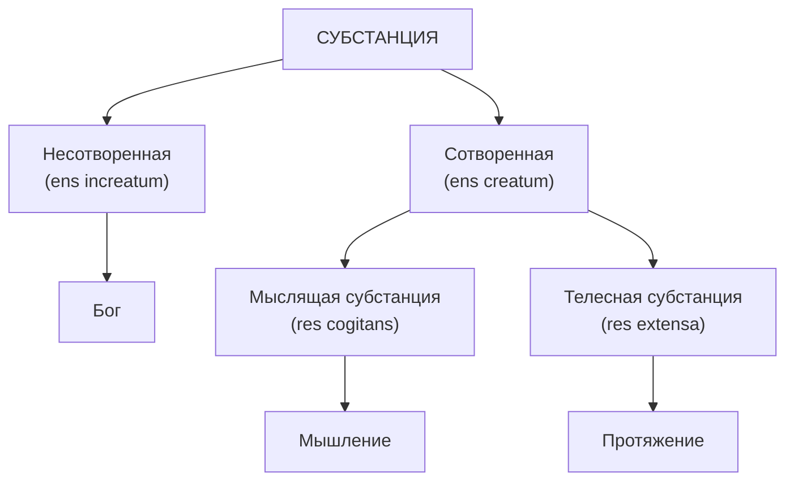

## Что такое субстанция?
1. полноценная вещь, которая существует сама по себе / не нуждается в другой вещи для существования.
2. субъект свойств.
3. имеет лишь один главный атрибут (мышление или протяжённость).
4. Главный атрибут выражает природу субстанции

## Главный атрибут
Первоначала философии, I, §53
И хотя субстанция познается на основании любого атрибута, однако каждой субстанции присуще какое-то одно главное свойство, образующее ее природу и сущность, причем с этим свойством связаны все остальные. А именно, протяженность в длину, ширину и глубину образует природу телесной субстанции, мышление же образует природу субстанции мыслящей. Ведь все прочее, что может быть приписано телу, предполагает протяженность и являет собой лишь некий модус протяженной вещи; равным образом всё, что мы усматриваем в уме, являет собой лишь различные модусы мышления. Так, например, фигуру можно мыслить лишь в протяженной вещи, равным образом и движение — лишь в протяженном пространстве; точно так же воображение, чувство, волю можно отнести лишь к мыслящей вещи. Напротив, протяженность может мыслиться без фигуры и движения, а мышление — без воображения или чувства, и то же самое относится к прочим субстанциям; всякому внимательному человеку это должно быть ясно.

## Аргумент реального различия 

Размышление 6: 

«...поскольку я знаю, что все, мыслимое мной ясно и отчетливо, может быть создано Богом таким, как я это мыслю, мне достаточно иметь возможность ясно и отчетливо помыслить одну вещь без другой, чтобы убедиться в их отличии друг от друга: ведь, по крайней мере, они могли быть разделены меж собой Богом; при этом не имеет значения, с помощью какой способности мы можем установить их различие. Таким образом, из одного того, что я уверен в своем существовании и в то же время не замечаю ничего иного, относящегося к моей природе, или сущности, помимо того, что я — вещь мыслящая, я справедливо заключаю, что сущность моя состоит лишь в том, что и — мыслящая вещь. И хотя, быть может (а как я скажу позднее, наверняка), я обладаю телом, теснейшим образом со мной сопряженным, все же, поскольку, с одной стороны, у меня есть ясная и отчетливая идея себя самого как вещи только мыслящей и не протяженной, а с другой — отчетливая идея тела как вещи исключительно протяженной, но не мыслящей, я убежден, что я поистине отличен от моего тела и могу существовать без него»

1. Бог может сделать всё то, что я могу постичь ясно и отчётливо.
2. Если я могу постичь одну вещь без другой, то эти вещи реально различны (так как могут быть разделены Богом).
3. Если бы я прекратил всякое мышление, я перестал бы существовать.
4. Моя природа — быть мыслящей вещью. 
5. Я могу ясно и отчётливо постичь, что могу существовать без своего тела.
6. Протяжённость (сущность тела) не принадлежит к моей сущности.
7. Я реально отличён от своего тела и могу существовать без него.

## Аргумент в пользу субстанциального дуализма:

1. [Главный атрибут] У субстанции может быть только один фундаментальный атрибут
2. [Ясные и отчетиливые идеи] Мышление и протяжение – два различных главных атрибута
3. Протяжение – главный атрибут телесной субстанции
4. (1, 2, 3) Мышление не может быть атрибутом телесной субстанции
5. Мышление — фундаментальный атрибут мыслящей субстанции
6. (1, 4, 5) Мыслящая субстанция отлична от телесной субстанции

## Мышление 

Я попытался устранить двусмысленность слова "мышление" в статьях 63 и 64 первой части "Начал". Подобно тому как протяжённость, составляющая природу тела, сильно отличается от различных фигур или модусов протяжённости, которые она принимает, — так и мышление, или мыслящая природа, которую я считаю составляющей сущность человеческого ума, весьма отлично от любого отдельного акта мышления. От самого ума зависит, производит ли он тот или иной отдельный акт мышления, но не то, что он есть мыслящая вещь; точно так же от пламени как действующей причины зависит, повернётся ли оно в эту или ту сторону, но не то, что оно есть протяжённая вещь. Итак, под "мышлением" я разумею не некое универсальное [понятие], которое охватывает все модусы мышления, но некую определённую природу, которая принимает эти модусы, — как протяжённость есть природа, принимающая все фигуры (à Arnauld, 29.07.1648; AT V, 221)
