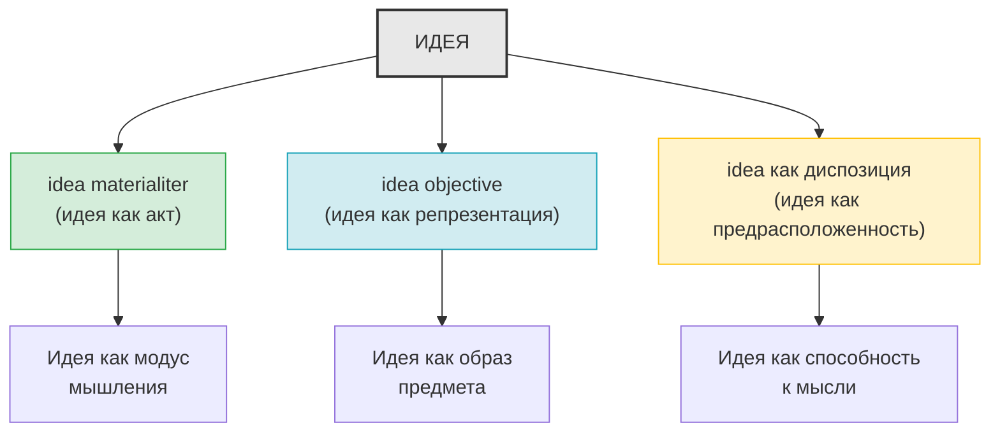

# Аргумент Катеруса 

Идея — это сама мыслимая вещь, поскольку она объективно содержится в интеллекте. Но что это значит — объективно содержаться в интеллекте? Некогда нас учили: это означает ограничение самого акта интеллекта мерой [modum] объекта. Однако это не что иное, как внешнее наименование: здесь нет ничего от вещи. Когда на меня смотрят, это означает не что иное, как направленность на меня акта зрения; точно так же, когда предмет мыслится или объективно содержится в интеллекте, это означает не что иное, как вызывать в себе акт мышления и одновременно его ограничение [mentis cogitationem in se sistere et terminare]; такой акт может совершиться, даже если объект не движется и не изменяется и даже если его вовсе не существует

# Ответ Декарта 

Здесь необходимо отметить, что он рассматривает самое вещь как внешнюю по отношению к интеллекту, и в этом смысле то, что вещь объективно содержится в интеллекте, несомненно, является чисто внешним наименованием; я **же говорю об идее, которая никогда не находится за пределами интеллекта** и по смыслу которой объективно содержаться [esse objective] означает не что иное, как содержаться в интеллекте таким образом, каким обычно содержатся в нем объекты. Например, если кто-нибудь спросит, что случится с солнцем, когда оно станет объективным содержанием моего интеллекта, лучшим ответом будет: единственное, что с ним случится,— оно получит внешнее наименование, ограничивающее действие интеллекта мерой объекта. Однако, если вопрос будет относиться к идее солнца — что она собой представляет? — и будет дан ответ, что она — мыслимая вещь, поскольку она объективно содержится в интеллекте, никто не поймет этого так, будто идея эта — само солнце, поскольку в нем содержится такое внешнее наименование; да и выражение это — объективно содержаться в интеллекте — обозначало там не ограничение действия интеллекта мерой объекта, но лишь то, что идея содержится в интеллекте таким образом, каким обычно содержатся в нем его объекты; таким образом, идея солнца есть не что иное, как само солнце, существующее в нашем интеллекте, причем не формально, как в небе, но объективно, т. е. так, как обычно присутствуют в интеллекте объекты; разумеется, подобный модус существования значительно менее совершенен, чем тот, в соответствии с которым вещи существуют вне интеллекта, но этот первый модус не есть по этой причине абсолютное ничто, как я и писал об этом раньше

----------------------------

